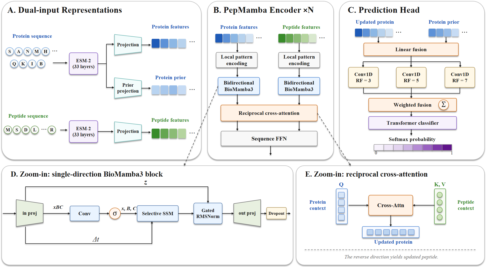

# PepMamba

PepMamba predicts protein–peptide interaction sites using ESM-2 residue representations, bidirectional BioMamba3 blocks, and reciprocal cross-attention.

## Architecture



## Requirements

- Python 3.10 and a CUDA-capable PyTorch environment
- PyTorch `>=2.0,<2.3`
- Mamba SSM `>=2.2.5,<3` and causal-conv1d `>=1.2.0,<2`
- fair-esm `==2.0.0` and fairscale `>=0.4.13,<1`
- NumPy `>=1.24,<2`, pandas `>=1.5,<3`, SciPy `>=1.10,<2`
- scikit-learn `>=1.3,<2` and einops `>=0.7,<1`

See `requirements.txt` for the complete dependency list.

## Installation

```bash
git clone <repository-url>
cd PepMamba
pip install -r requirements.txt
```

## Data Preparation

Fixed train/validation/test CSV files are provided in `data/`. Protein and peptide inputs use 1,280-dimensional residue-level representations from `esm2_t33_650M_UR50D`. Generate `protein_esm2.pkl` and `peptide_esm2.pkl` with:

```bash
python scripts/prepare_pair_esm2_embeddings.py --data-dir data --output-dir .
```

The paper also reports an additional external evaluation on the CPPIF external benchmark. Its fixed splits are provided in `data/cppif/`, with ESM-2 preparation available in `scripts/prepare_cppif_esm2_embeddings.py`; it is separate from the four main benchmarks listed below.

## Quick Start

Supported dataset keys are `bitenet`, `interpep`, `pepbind`, and `pepnn`.

```bash
python train.py --dataset <dataset>
python test.py --dataset <dataset>
```

All runs use seed 42; the paper checkpoint epoch and classification threshold for each dataset are fixed in `config.py`.

## License

PepMamba is released under the [Apache License 2.0](LICENSE). See [THIRD_PARTY_NOTICES](THIRD_PARTY_NOTICES) for third-party attribution.

## Citation

Please cite the accompanying PepMamba paper. The final BibTeX entry and DOI will be added after acceptance or preprint publication.
